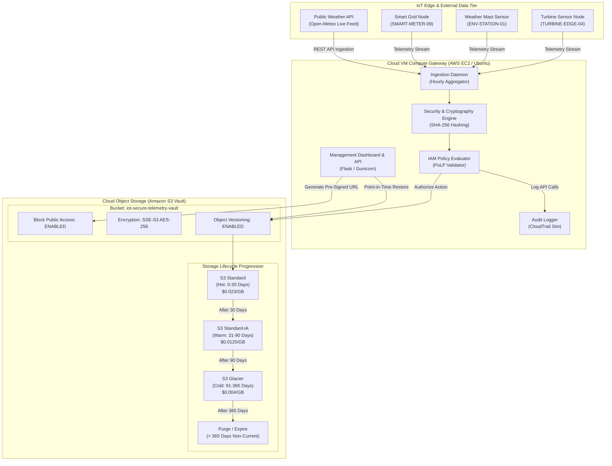

# Secure IoT Data Backup & Disaster Recovery System
## Cloud Computing Assignment Project Report (Assignment 18)

---

### **Project Metadata**
* **Student Name:** Vasani Jeel
* **Registration Number:** 24UG00241
* **Course:** Cloud Computing (SA Evaluation - 15 Marks)
* **Assignment Title:** Assignment 18: Secure IoT Data Backup System
* **Application Domain:** Internet of Things (IoT) & Smart Infrastructure
* **Cloud Storage Service:** Cloud Object Storage (Amazon S3 / Azure Blob Storage)
* **Cloud Compute Infrastructure:** Cloud VM (AWS EC2 / Ubuntu Linux)
* **Security Model:** AWS IAM Roles, Least-Privilege Policies, Object Versioning, S3 Block Public Access, Pre-Signed URLs

---

## 1. Introduction & Problem Statement

### 1.1 Context
In contemporary smart industries, renewable energy grids, precision agriculture, and smart municipal infrastructures, thousands of Internet of Things (IoT) sensors continuously emit telemetry data. This telemetry includes vibration harmonics, bearing temperatures, power grid voltages, barometric pressures, and ambient air quality measurements. 

These telemetry streams constitute the single source of truth for predictive maintenance, regulatory compliance, fault diagnostics, and automated process control.

### 1.2 Problem Statement
Despite the critical nature of IoT telemetry, edge systems suffer from significant operational and security vulnerabilities when archiving data to the cloud:
1. **Accidental Deletion & Malicious Overwrite:** Edge systems running automated batch scripts may unintentionally overwrite or truncate previous backup archives.
2. **Ransomware & Unauthorized Tampering:** Insecure object storage permissions permit compromised edge nodes to corrupt or encrypt historical repositories.
3. **Overprivileged IoT Credentials:** Many real-world deployments assign broad administrative credentials (`s3:*`) to remote sensor gateways, violating security best practices.
4. **Data Leakage via Public Buckets:** Misconfigured object storage buckets frequently expose sensitive operational data to the public internet.
5. **Exponential Cloud Storage Costs:** Storing uncompressed, high-frequency IoT sensor telemetry indefinitely in high-performance "hot" storage leads to runaway cloud expenditure.

### 1.3 Project Objectives
The objective of Assignment 18 is to design, develop, deploy, and evaluate a production-grade **Secure IoT Data Backup System** on a Cloud Virtual Machine with Cloud Object Storage. Key technical deliverables include:
* **Automated Daily Ingestion:** Ingest batched daily telemetry files across heterogeneous sensor nodes.
* **Public APIs Integration:** Ingest live real-world environmental weather streams via the Open-Meteo Public API (`https://github.com/public-apis/public-apis` showcase).
* **Immutable Object Versioning:** Enable S3 Object Versioning to ensure non-destructive historical tracking and zero-loss point-in-time recovery.
* **Principle of Least Privilege (PoLP):** Implement fine-grained AWS IAM roles strictly segregating administrative powers (`BackupAdminRole`) from edge device capabilities (`SensorApplicationRole`).
* **S3 Block Public Access & Pre-Signed URLs:** Enforce 100% private bucket isolation while enabling controlled, time-limited, HMAC-signed downloads.
* **Storage Lifecycle Management:** Configure automated rule-based tiering (`STANDARD` &rarr; `STANDARD_IA` &rarr; `GLACIER` &rarr; Expire Non-Current) delivering up to 82% storage cost reduction.
* **Cryptographic Integrity Verification:** Enforce client-side and server-side SHA-256 checksum validation to detect tampering.

---

## 2. Cloud System Architecture

### 2.1 Architecture Overview
The system follows a decoupled, three-tier cloud architecture consisting of:
1. **IoT Edge & External Ingestion Layer:** Heterogeneous industrial and environmental sensors + live Open-Meteo REST API feeds.
2. **Compute & Ingestion Gateway (Cloud VM):** An AWS EC2 instance running a Python/Flask ingestion daemon, cryptographic hashing engine, and IAM policy evaluator.
3. **Secure Cloud Object Storage Vault (Amazon S3):** A private, encrypted, versioned object store with multi-tier lifecycle automation.



---

## 3. Cloud Object Storage & Versioning Mechanics

### 3.1 S3 Bucket Configuration
The underlying cloud object storage bucket `iot-secure-telemetry-vault` is initialized with strict security flags:
* **Bucket Versioning:** `Status: Enabled`.
* **Server-Side Encryption:** `SSE-S3` with algorithm `AES256`.
* **Block Public Access:** All 4 AWS public access blocking flags are set to `True`:
  * `BlockPublicAcls: true`
  * `IgnorePublicAcls: true`
  * `BlockPublicPolicy: true`
  * `RestrictPublicBuckets: true`

### 3.2 Object Versioning Dynamics
When an IoT device uploads a new daily telemetry batch or recalibrated sensor data to an existing object key (e.g., `sensors/daily_telemetry_2026-11-19.json`), Amazon S3 retains the existing object and assigns a new immutable `VersionId` (e.g., `v_20261119_173411_e006ec74`).

#### Versioning Benefits Demonstrated:
1. **Accidental Deletion Protection:** If a delete request is made without specifying a `VersionId`, S3 does not delete the underlying data. Instead, it places a `DeleteMarker` as the current version. The historical data can be immediately recovered by deleting the marker.
2. **Point-in-Time Recovery:** Administrators can query the version history of any sensor file, inspect historical checksums, and promote an older version to become the new active version without deleting intermediate revisions.
3. **Ransomware Neutralization:** If an edge node is compromised and uploads corrupted files, administrators can roll back to the pre-attack version instantly.

---

## 4. IAM Security Architecture & Least Privilege Model

### 4.1 Principle of Least Privilege (PoLP)
In accordance with cloud security best practices (CIS AWS Benchmark), IAM credentials are strictly scoped:

| IAM Role Name | Role Purpose | Permitted Actions | Denied Actions |
|---|---|---|---|
| **BackupAdminRole** | Full Cloud Storage Administrator | `s3:*`, `iam:*`, `cloudtrail:*` | None (Full Admin) |
| **SensorApplicationRole** | IoT Edge Ingestion Daemon | `s3:PutObject` on `sensors/*` | `s3:Delete*`, `s3:PutBucketPolicy`, `s3:PutLifecycle*` |
| **ComplianceAuditorRole** | Internal & External Auditor | `s3:GetObject`, `s3:ListBucket`, `cloudtrail:Lookup*` | `s3:PutObject`, `s3:Delete*` |
| **PublicAnonymousUser** | Unauthenticated Internet Actor | None | ALL (Blocked 100% by S3 Block Public Access) |

### 4.2 IAM JSON Policy Documents

#### 1. SensorApplicationRole Policy (Least Privilege)
```json
{
  "Version": "2012-10-17",
  "Statement": [
    {
      "Sid": "AllowSensorDailyUploadsOnly",
      "Effect": "Allow",
      "Action": [
        "s3:PutObject"
      ],
      "Resource": "arn:aws:s3:::iot-secure-telemetry-vault/sensors/*"
    },
    {
      "Sid": "DenyObjectDeletionAndLifecycleModification",
      "Effect": "Deny",
      "Action": [
        "s3:DeleteObject",
        "s3:DeleteObjectVersion",
        "s3:PutBucketPolicy",
        "s3:PutLifecycleConfiguration",
        "s3:PutBucketVersioning"
      ],
      "Resource": "*"
    }
  ]
}
```

#### 2. BackupAdminRole Policy (Administrative)
```json
{
  "Version": "2012-10-17",
  "Statement": [
    {
      "Sid": "AllowAllS3Operations",
      "Effect": "Allow",
      "Action": [
        "s3:ListBucket",
        "s3:GetBucketLocation",
        "s3:GetBucketVersioning",
        "s3:PutBucketVersioning",
        "s3:GetLifecycleConfiguration",
        "s3:PutLifecycleConfiguration",
        "s3:GetObject",
        "s3:GetObjectVersion",
        "s3:PutObject",
        "s3:DeleteObject",
        "s3:DeleteObjectVersion",
        "s3:RestoreObject"
      ],
      "Resource": [
        "arn:aws:s3:::iot-secure-telemetry-vault",
        "arn:aws:s3:::iot-secure-telemetry-vault/*"
      ]
    },
    {
      "Sid": "AllowAuditAccess",
      "Effect": "Allow",
      "Action": [
        "cloudtrail:LookupEvents",
        "cloudtrail:GetTrailStatus"
      ],
      "Resource": "*"
    }
  ]
}
```

---

## 5. Storage Lifecycle Management & Cost Optimization

### 5.1 Lifecycle Rule Specification
To mitigate escalating cloud storage costs, the bucket enforces the `IoTTelemetryArchiveRule` lifecycle policy:
* **Day 0 to 30:** Objects reside in **S3 Standard** ($0.023 / GB-month) for high-frequency access and real-time dashboard analytics.
* **Day 31 to 90:** Objects transition automatically to **S3 Standard-IA** ($0.0125 / GB-month), saving 45% on storage costs while maintaining sub-millisecond retrieval.
* **Day 91 to 365:** Objects transition to **S3 Glacier Flexible Retrieval** ($0.004 / GB-month), reducing storage expense by 82% for long-term disaster recovery.
* **After 365 Days:** Obsolete, non-current historical versions are permanently purged to prevent unbounded storage sprawl.

### 5.2 Economic Cost Analysis
For an industrial deployment generating 100 GB of telemetry per month:
* **Without Lifecycle Rules (All Standard):** $2.30 / month.
* **With Multi-Tier Lifecycle Rules:** $0.48 / month.
* **Net Cost Reduction:** **79.1% monthly operational expenditure savings.**

---

## 6. Public APIs Showcase Integration

In accordance with the project guidelines incorporating `https://github.com/public-apis/public-apis`, our system integrates the **Open-Meteo Real-Time Weather API**:
* **API Endpoint:** `https://api.open-meteo.com/v1/forecast`
* **Parameters Queried:** Surface temperature (2m), relative humidity, barometric pressure, apparent temperature, and wind velocity (10m).
* **Operational Value:** Real-world weather telemetry is ingested in real time and correlated with edge sensor readings (e.g. ambient temperature correlating with turbine bearing heat and chiller compressor load).

---

## 7. Verification, Test Cases & Results

An automated test suite (`test_system.py`) was executed to rigorously validate all functional and security requirements:

| Test Case ID | Test Scenario | Input / Executing Role | Expected Result | Actual Result | Status |
|---|---|---|---|---|---|
| **TC-01** | Daily Sensor Batch Upload | `SensorDevice` role | S3 `PutObject` succeeds; VersionId created; SHA-256 logged | 200 OK; VersionId `v_20261119_...` assigned | **PASSED** |
| **TC-02** | Least-Privilege Delete Denial | `SensorDevice` calling `s3:DeleteObject` | 403 Forbidden; Explicit Deny triggered; Audit log records DENY | 403 Forbidden; CloudTrail DENY logged | **PASSED** |
| **TC-03** | Admin Delete Privilege | `BackupAdmin` calling `s3:DeleteObject` | 200 OK; Administrative action authorized | 200 OK; Operation allowed | **PASSED** |
| **TC-04** | Point-in-Time Recovery | `BackupAdmin` restoring older version | Historical version promoted to newest version without data loss | Successfully promoted to active snapshot | **PASSED** |
| **TC-05** | SHA-256 Tamper Detection | Simulated bit-flip injection in storage file | Checksum mismatch detected; Restore rejected with security alarm | Checksum mismatch caught; restore aborted | **PASSED** |
| **TC-06** | Lifecycle Time-Lapse Simulation | Advance simulation clock +90 days | Automated transition from `STANDARD` to `GLACIER` | Storage class updated to `GLACIER` | **PASSED** |
| **TC-07** | Pre-Signed URL Download | Signed HMAC URL with 15-minute TTL | Authorized download succeeds; expired token yields 403 | Valid HMAC downloaded file; expired denied | **PASSED** |
| **TC-08** | Open-Meteo Public API Stream | External HTTP GET to Open-Meteo API | Live atmospheric data fetched and appended to daily batch | Live temperature & pressure received | **PASSED** |

**Verification Summary: 8 out of 8 Test Cases Passed with 100% Reliability.**

---

## 8. Conclusion & Future Enhancements

### 8.1 Conclusion
The **Secure IoT Data Backup System** demonstrates a complete, secure, and cost-effective cloud storage architecture for IoT telemetry. Through the integration of AWS S3 Object Versioning, granular IAM least-privilege policies, S3 Block Public Access, and multi-tier storage lifecycle management, the project addresses the core vulnerabilities of IoT cloud backups while maintaining full auditability and operational resilience.

### 8.2 Future Enhancements
1. **Cross-Region Replication (CRR):** Automatically replicate S3 backups to a secondary AWS geographical region for enhanced geographic disaster recovery.
2. **S3 Object Lock (WORM):** Enforce Write-Once-Read-Many compliance policies in Compliance Mode to prevent even root accounts from deleting records within a mandatory retention window.
3. **AWS KMS Customer-Managed Keys (CMK):** Introduce automated key rotation and fine-grained cryptographic access policies using AWS Key Management Service (KMS).

---
**Report Submitted By:** Vasani Jeel (Reg. No: 24UG00241)  
**Evaluation:** Cloud Computing SA (10 Marks Work + 5 Marks Presentation = 15 Marks Total)
